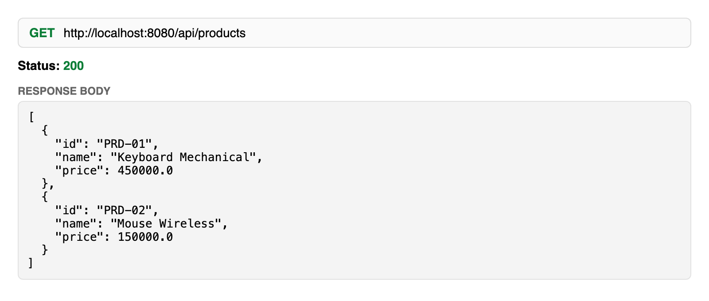
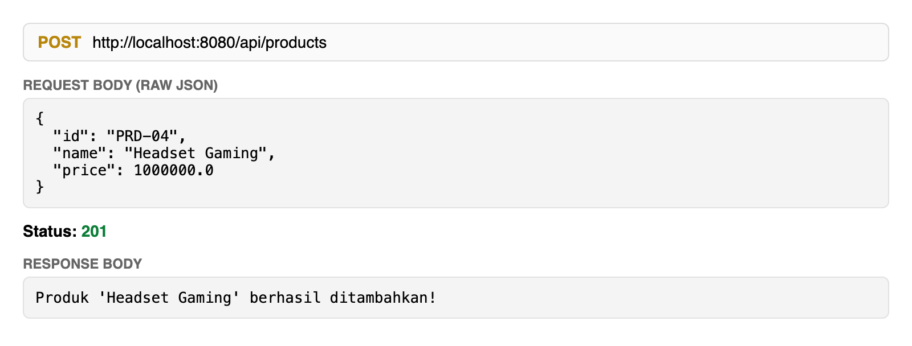
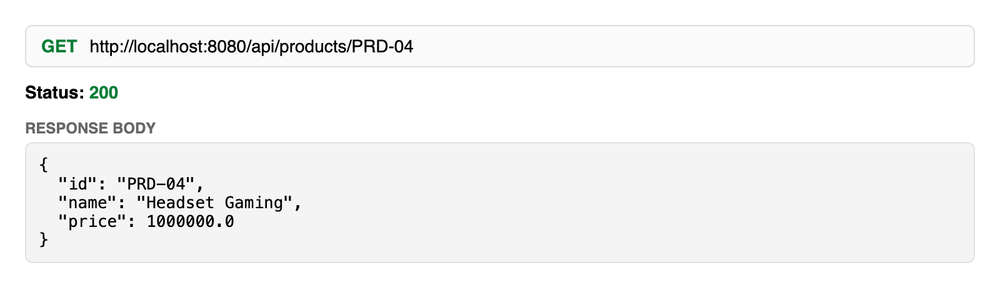
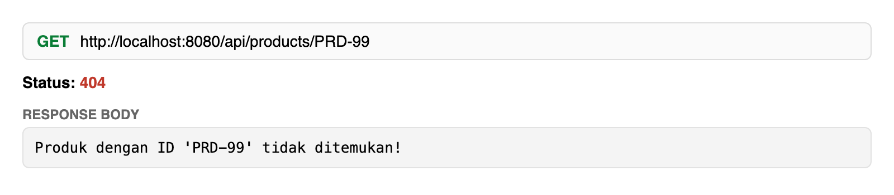
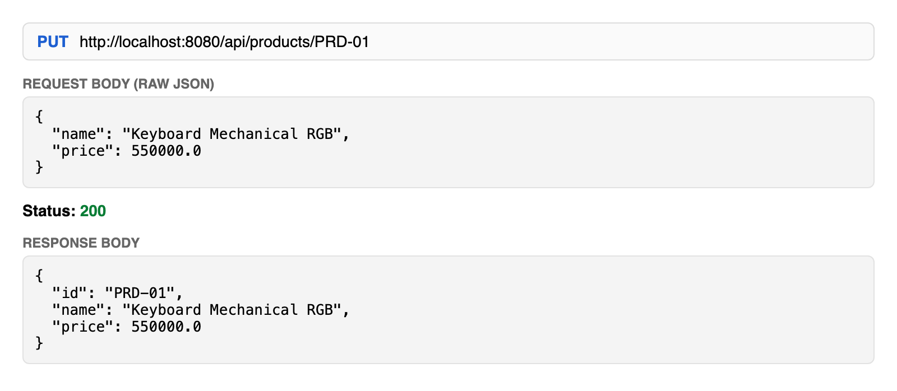
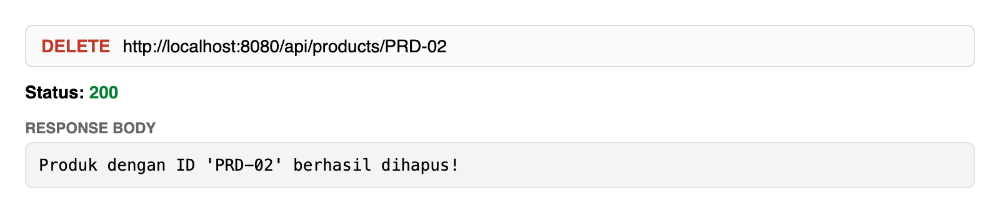
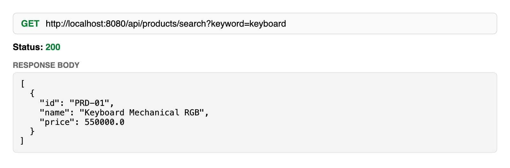

# Laporan Tugas Pertemuan 5: Building Basic REST API with Spring Boot

- Nama: Rendika Adji Putra
- NIM: 2411501717
- Mata kuliah: Pemrograman Java Web dan Enterprise (PG191), Semester Ganjil 2026/2027
- Dosen: Riskiana Wulan, S.Kom, M.Kom

## Tujuan

Membangun `ProductController` berbasis REST API pada project Spring Boot `product-catalog`, lalu menguji CRUD lengkap beserta Mini Challenge (pencarian produk berdasarkan nama).

## Teknologi

- Java 17, Spring Boot (dependency: Spring Web)
- Maven (`mvnw` sudah disertakan)
- Penyimpanan in-memory (`ArrayList`), sehingga data kembali ke awal setiap aplikasi di-restart

## Struktur Project

```
product-catalog/src/main/java/com/budiluhur/catalog
├── ProductCatalogApplication.java
├── controller/ProductController.java
├── exception/ProductNotFoundException.java
├── model/Product.java
├── repository/ProductRepository.java
└── service/ProductService.java
```

## Cara Menjalankan

```bash
cd product-catalog
./mvnw spring-boot:run
```

Aplikasi berjalan di `http://localhost:8080`. Data awal: `PRD-01` (Keyboard Mechanical, 450000) dan `PRD-02` (Mouse Wireless, 150000).

## Daftar Endpoint

| Method | URL | Keterangan | Status |
|---|---|---|---|
| GET | `/api/products` | Ambil semua produk | 200 |
| GET | `/api/products/{id}` | Ambil produk berdasarkan ID | 200 / 404 |
| GET | `/api/products/search?keyword=...` | Cari produk berdasarkan nama (Mini Challenge) | 200 |
| POST | `/api/products` | Tambah produk | 201 |
| PUT | `/api/products/{id}` | Ubah nama dan harga produk | 200 / 404 |
| DELETE | `/api/products/{id}` | Hapus produk | 200 / 404 |

## Bukti Pengujian

Pengujian dilakukan berurutan pada satu kali menjalankan aplikasi. Setiap screenshot menampilkan request dan response asli dari server yang berjalan.

### 1. GET semua produk

Hasil: 200 OK, JSON array berisi 2 produk awal.



### 2. POST tambah produk

Hasil: 201 Created dengan pesan sukses.



### 3. GET produk berdasarkan ID (sukses)

Hasil: 200 OK dan data produk. Memakai `PRD-04` karena produk ini baru ditambahkan pada langkah 2.



### 4. GET produk berdasarkan ID (tidak ditemukan)

Hasil: 404 Not Found dengan pesan error.



### 5. PUT ubah produk

Hasil: 200 OK dan JSON produk yang sudah diperbarui.



### 6. DELETE hapus produk

Hasil: 200 OK dengan pesan penghapusan.



### 7. Mini Challenge: pencarian produk

Endpoint `GET /api/products/search?keyword=keyboard` memakai `@RequestParam("keyword")`. Filter di `ProductRepository.searchByName` memakai `product.getName().toLowerCase().contains(keyword.toLowerCase())`, jadi pencarian tidak membedakan huruf besar dan kecil. Produk `PRD-01` sudah berubah menjadi "Keyboard Mechanical RGB" dari langkah 5.



## Catatan

- Request dikirim dengan `curl`, lalu hasilnya ditampilkan dalam panel mirip Postman untuk di-screenshot. Request yang sama (method, URL, header `Content-Type: application/json`, body raw JSON) bisa diulang langsung di Postman.
- Data bersifat in-memory, jadi akan hilang saat aplikasi di-restart. Penyimpanan permanen dibahas di Minggu 6 (Spring Data JPA).
